# Diagramas de Comunicación UML (Robustness / Análisis BCE)
## Sistema de Información para la Gestión, Programación y Control de Citas Médicas - Clínica Vida Salud
**Universidad Autónoma Gabriel René Moreno (UAGRM) — Facultad de Ingeniería en Ciencias de la Computación y Telecomunicaciones**

---

### 1. Marco Metodológico y Notación de Robustez (BCE)

Siguiendo el estándar del **Proceso Unificado de Desarrollo de Software (PUDS / RUP)** y el análisis de robustez de Ivar Jacobson, los **Diagramas de Comunicación UML** modelan la colaboración estructural entre los objetos del sistema para materializar cada caso de uso.

#### Simbología Aplicada (Notación Formal UML / Enterprise Architect):
1. **Actores (`Actor` con `{from Análisis}`):** Usuarios del sistema que inician o reciben el flujo de eventos (`Administrador`, `Recepcionista`, `Médico`, `Paciente`).
2. **Frontera / Boundary (`|-○` - Círculo con barra lateral izquierda):** Componentes de interfaz de usuario, vistas y modales desarrollados en Vue 3 / Inertia.js (ej. `Usuarios.vue`, `ModalProgramarCita.vue`).
3. **Control (`↻○` - Círculo con flecha curva horaria superior):** Controladores de backend en Laravel 12 y servicios de negocio encargados de procesar la lógica, validar reglas y coordinar transacciones (ej. `UsuarioController`, `CitaController`, `DisponibilidadCitaService`, `BitacoraService`).
4. **Entidad (`_○_` - Círculo con barra horizontal inferior):** Modelos Eloquent y tablas de datos relacionales persistentes en PostgreSQL (ej. `UsuarioModel`, `PersonaModel`, `CitaModel`, `bitacora`).
5. **Mensajes Numerados (`n: metodo(parametros)`):** Enlaces directos dirigidos con flechas que indican el orden cronológico y la invocación exacta de funciones presentes en el código fuente.

---

### 2. Catálogo de los 17 Diagramas de Comunicación Generados

| Caso de Uso | Título | Actor(es) | Archivo de Imagen Generado |
| :---: | :--- | :--- | :--- |
| **CU-01** | Gestionar Usuarios | Administrador | [`docs/diagramas/comunicacion/CU01_Gestionar_Usuarios.png`](./comunicacion/CU01_Gestionar_Usuarios.png) |
| **CU-02** | Gestionar Roles y Permisos | Administrador | [`docs/diagramas/comunicacion/CU02_Gestionar_Roles_Permisos.png`](./comunicacion/CU02_Gestionar_Roles_Permisos.png) |
| **CU-03** | Consultar Bitácora de Auditoría | Administrador | [`docs/diagramas/comunicacion/CU03_Consultar_Bitacora.png`](./comunicacion/CU03_Consultar_Bitacora.png) |
| **CU-04** | Gestionar Respaldos de Base de Datos | Administrador | [`docs/diagramas/comunicacion/CU04_Gestionar_Respaldos.png`](./comunicacion/CU04_Gestionar_Respaldos.png) |
| **CU-05** | Gestionar Especialidades | Administrador | [`docs/diagramas/comunicacion/CU05_Gestionar_Especialidades.png`](./comunicacion/CU05_Gestionar_Especialidades.png) |
| **CU-06** | Gestionar Médicos | Administrador | [`docs/diagramas/comunicacion/CU06_Gestionar_Medicos.png`](./comunicacion/CU06_Gestionar_Medicos.png) |
| **CU-07** | Gestionar Perfil Médico Base | Médico | [`docs/diagramas/comunicacion/CU07_Gestionar_Perfil_Medico.png`](./comunicacion/CU07_Gestionar_Perfil_Medico.png) |
| **CU-08** | Gestionar Pacientes | Recepcionista | [`docs/diagramas/comunicacion/CU08_Gestionar_Pacientes.png`](./comunicacion/CU08_Gestionar_Pacientes.png) |
| **CU-09** | Configurar Horarios Regulares de Atención | Administrador | [`docs/diagramas/comunicacion/CU09_Configurar_Horarios.png`](./comunicacion/CU09_Configurar_Horarios.png) |
| **CU-10** | Gestionar Excepciones y Ausencias Médicas | Médico | [`docs/diagramas/comunicacion/CU10_Gestionar_Ausencias_Medicas.png`](./comunicacion/CU10_Gestionar_Ausencias_Medicas.png) |
| **CU-11** | Programar Cita Médica | Recepcionista, Paciente | [`docs/diagramas/comunicacion/CU11_Programar_Cita_Medica.png`](./comunicacion/CU11_Programar_Cita_Medica.png) |
| **CU-12** | Reprogramar Cita Médica | Recepcionista, Paciente | [`docs/diagramas/comunicacion/CU12_Reprogramar_Cita_Medica.png`](./comunicacion/CU12_Reprogramar_Cita_Medica.png) |
| **CU-13** | Cancelar Cita Médica | Recepcionista, Paciente | [`docs/diagramas/comunicacion/CU13_Cancelar_Cita_Medica.png`](./comunicacion/CU13_Cancelar_Cita_Medica.png) |
| **CU-14** | Registrar Atención de Paciente | Médico | [`docs/diagramas/comunicacion/CU14_Registrar_Atencion_Paciente.png`](./comunicacion/CU14_Registrar_Atencion_Paciente.png) |
| **CU-15** | Consultar Historial de Citas | Recepcionista | [`docs/diagramas/comunicacion/CU15_Consultar_Historial_Citas.png`](./comunicacion/CU15_Consultar_Historial_Citas.png) |
| **CU-16** | Generar Reportes Administrativos | Administrador | [`docs/diagramas/comunicacion/CU16_Generar_Reportes_Administrativos.png`](./comunicacion/CU16_Generar_Reportes_Administrativos.png) |
| **CU-17** | Exportar Datos a .xlsx | Administrador | [`docs/diagramas/comunicacion/CU17_Exportar_Datos_XLSX.png`](./comunicacion/CU17_Exportar_Datos_XLSX.png) |

---

### 3. Detalle de Trazabilidad Técnica por Caso de Uso

#### CU-01: Gestionar Usuarios
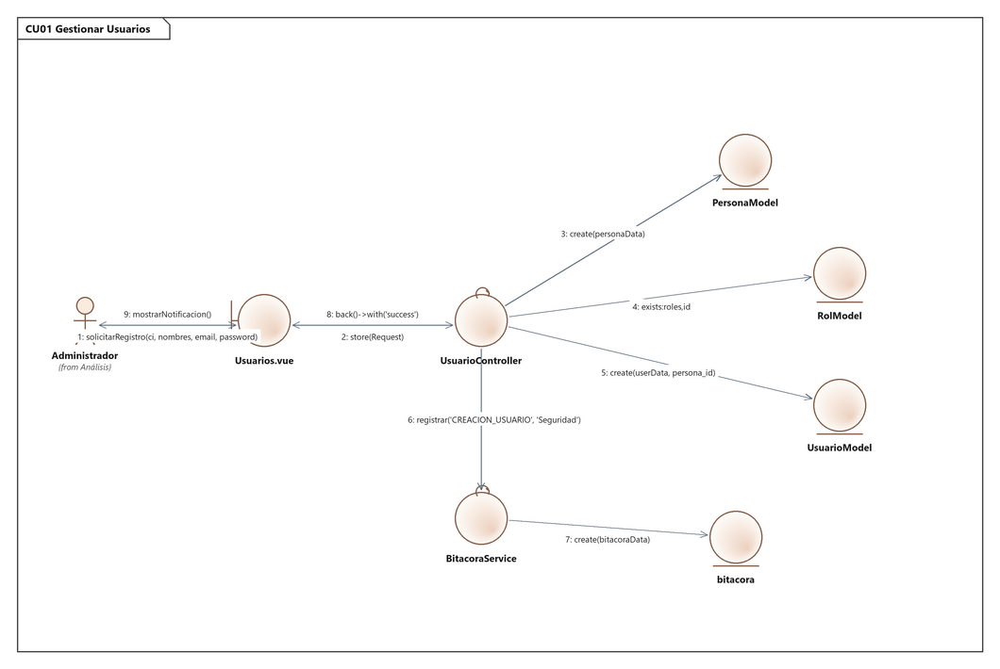
- **Actores:** `Administrador {from Análisis}`.
- **Frontera:** `Usuarios.vue` (`resources/js/Pages/Usuarios/Index.vue`).
- **Control:** `UsuarioController`, `BitacoraService`.
- **Entidades:** `PersonaModel`, `RolModel`, `UsuarioModel`, `bitacora`.
- **Trazabilidad de Código:**
  1. `solicitarRegistro()`: Envío del formulario reactivo de usuario y datos personales.
  2. `store(Request)`: Enrutado a `UsuarioController@store`.
  3. `create(personaData)`: Transacción con inserción en tabla `personas` (`PersonaModel::create`).
  4. `exists:roles,id`: Validación de clave foránea `rol_id` en tabla `roles`.
  5. `create(userData, persona_id)`: Hash Bcrypt de contraseña e inserción en tabla `usuarios`.
  6. `registrar('CREACION_USUARIO', 'Seguridad')`: Invocación del servicio estático `BitacoraService::registrar()`.
  7. `create(bitacoraData)`: Inserción atómica en `BitacoraModel`.
  8. `back()->with('success')`: Retorno de redirección Inertia con mensaje de confirmación.
  9. `mostrarNotificacion()`: Notificación de éxito en la interfaz.

---

#### CU-02: Gestionar Roles y Permisos
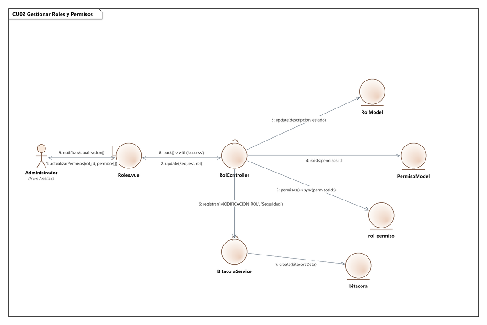
- **Actores:** `Administrador {from Análisis}`.
- **Frontera:** `Roles.vue` (`resources/js/Pages/Roles/Index.vue`).
- **Control:** `RolController`, `BitacoraService`.
- **Entidades:** `RolModel`, `PermisoModel`, `rol_permiso`, `bitacora`.
- **Trazabilidad de Código:**
  1. `actualizarPermisos()`: Selección en grilla de permisos por módulo del sistema.
  2. `update(Request, rol)`: Enrutado a `RolController@update`.
  3. `update(descripcion, estado)`: Actualización del registro en `roles`.
  4. `exists:permisos,id`: Validación de IDs en catálogo de `permisos`.
  5. `permisos()->sync(permisosIds)`: Sincronización en tabla intermedia `rol_permiso`.
  6. `registrar('MODIFICACION_ROL', 'Seguridad')`: Auditoría en `BitacoraService`.
  7. `back()->with('success')`: Redirección y confirmación visual.

---

#### CU-03: Consultar Bitácora de Auditoría
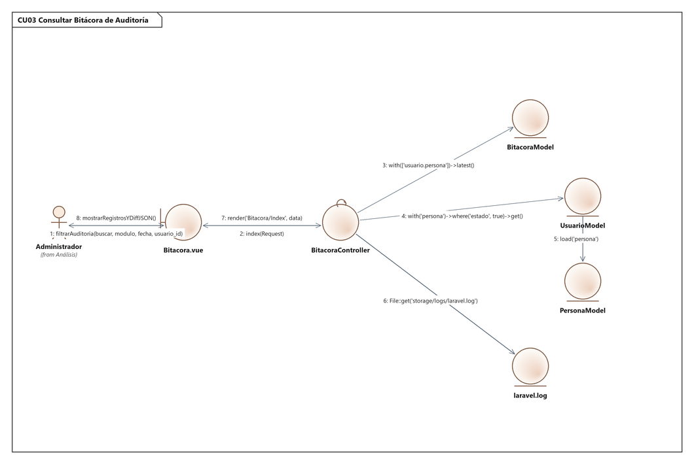
- **Actores:** `Administrador {from Análisis}`.
- **Frontera:** `Bitacora.vue` (`resources/js/Pages/Bitacora/Index.vue`).
- **Control:** `BitacoraController`.
- **Entidades:** `BitacoraModel`, `UsuarioModel`, `PersonaModel`, `laravel.log`.
- **Trazabilidad de Código:**
  1. `filtrarAuditoria()`: Búsqueda por rango de fechas, usuario, acción o módulo.
  2. `index(Request)`: Enrutado a `BitacoraController@index`.
  3. `with(['usuario.persona'])->latest()`: Carga ansiosa (*eager loading*) de la pista de auditoría.
  4. `with('persona')->where('estado', true)->get()`: Carga del catálogo de usuarios activos.
  5. `File::get('storage/logs/laravel.log')`: Extracción de las últimas líneas del registro del servidor.
  6. `render('Bitacora/Index', data)`: Respuesta Inertia y renderizado de la consola de auditoría.

---

#### CU-04: Gestionar Respaldos de Base de Datos
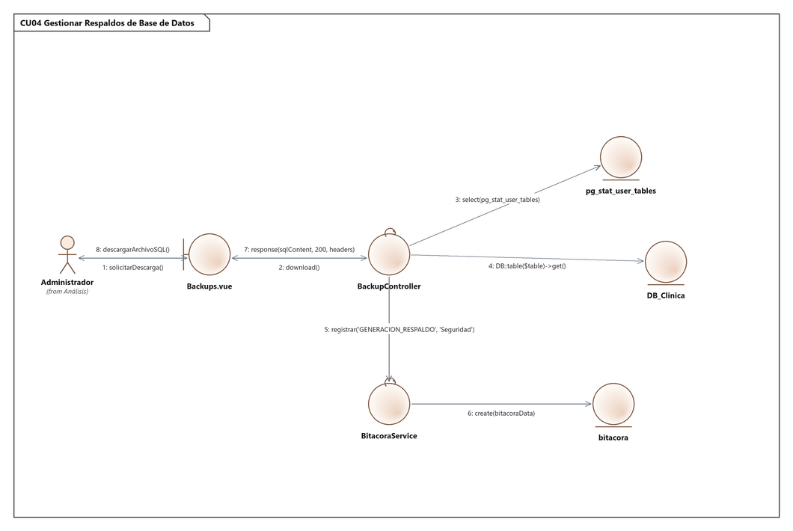
- **Actores:** `Administrador {from Análisis}`.
- **Frontera:** `Backups.vue` (`resources/js/Pages/Backups/Index.vue`).
- **Control:** `BackupController`, `BitacoraService`.
- **Entidades:** `pg_stat_user_tables`, `DB_Clinica`, `bitacora`.
- **Trazabilidad de Código:**
  1. `solicitarDescarga()`: Solicitud de copia de seguridad integral.
  2. `download()`: Enrutado a `BackupController@download`.
  3. `select(pg_stat_user_tables)`: Obtención del conteo de filas y tamaño de tablas.
  4. `DB::table($table)->get()`: Volcado secuencial estructurado de los registros.
  5. `registrar('GENERACION_RESPALDO', 'Seguridad')`: Registro de auditoría con nombre de archivo SQL.
  6. `response(sqlContent, 200, headers)`: Descarga forzada como `application/sql`.

---

#### CU-05: Gestionar Especialidades
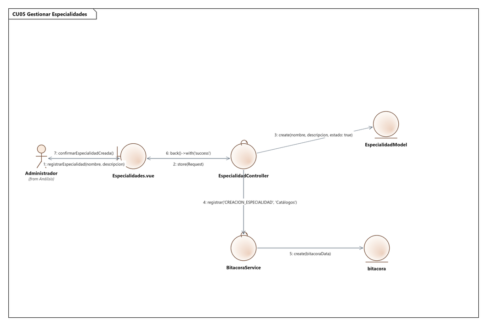
- **Actores:** `Administrador {from Análisis}`.
- **Frontera:** `Especialidades.vue` (`resources/js/Pages/Especialidades/Index.vue`).
- **Control:** `EspecialidadController`, `BitacoraService`.
- **Entidades:** `EspecialidadModel`, `bitacora`.
- **Trazabilidad de Código:**
  1. `registrarEspecialidad()`: Formulario modal de nueva especialidad.
  2. `store(Request)`: Invocación en `EspecialidadController@store`.
  3. `create(nombre, descripcion, estado: true)`: Persistencia en `especialidades`.
  4. `registrar('CREACION_ESPECIALIDAD', 'Catálogos')`: Auditoría de la nueva especialidad.
  5. `back()->with('success')`: Cierre de modal y actualización reactiva de la grilla.

---

#### CU-06: Gestionar Médicos
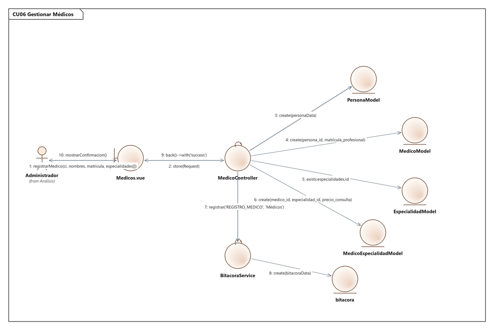
- **Actores:** `Administrador {from Análisis}`.
- **Frontera:** `Medicos.vue` (`resources/js/Pages/Medicos/Index.vue`).
- **Control:** `MedicoController`, `BitacoraService`.
- **Entidades:** `PersonaModel`, `MedicoModel`, `EspecialidadModel`, `MedicoEspecialidadModel`, `bitacora`.
- **Trazabilidad de Código:**
  1. `registrarMedico()`: Formulario con asignación de múltiples especialidades y aranceles.
  2. `store(Request)`: `MedicoController@store` envuelto en `DB::transaction()`.
  3. `create(personaData)`: Creación de la identidad física en `personas`.
  4. `create(persona_id, matricula_profesional)`: Alta médica en tabla `medicos`.
  5. `create(medico_id, especialidad_id, precio_consulta)`: Configuración del arancel en `medico_especialidad`.
  6. `registrar('REGISTRO_MEDICO', 'Médicos')`: Registro en `BitacoraService`.

---

#### CU-07: Gestionar Perfil Médico Base
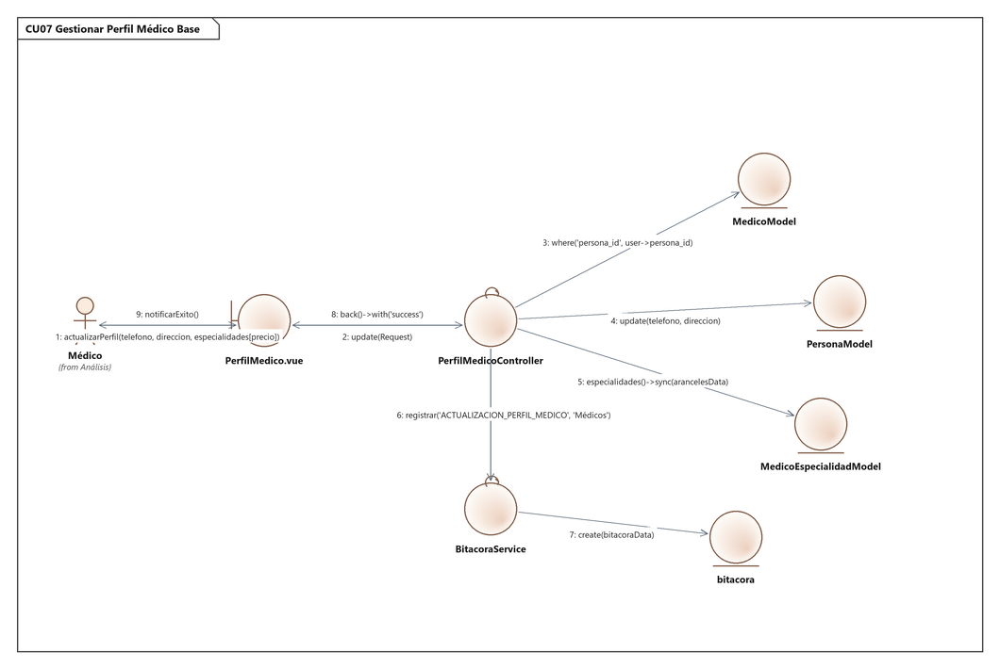
- **Actores:** `Médico {from Análisis}`.
- **Frontera:** `PerfilMedico.vue` (`resources/js/Pages/Medicos/Perfil.vue`).
- **Control:** `PerfilMedicoController`, `BitacoraService`.
- **Entidades:** `MedicoModel`, `PersonaModel`, `MedicoEspecialidadModel`, `bitacora`.
- **Trazabilidad de Código:**
  1. `actualizarPerfil()`: El médico actualiza su teléfono, dirección y tarifas por especialidad.
  2. `update(Request)`: Enrutado a `PerfilMedicoController@update`.
  3. `where('persona_id', user->persona_id)`: Resolución del médico autenticado.
  4. `update(telefono, direccion)`: Actualización de contacto en `PersonaModel`.
  5. `especialidades()->sync(arancelesData)`: Actualización de tarifas en `medico_especialidad`.
  6. `registrar('ACTUALIZACION_PERFIL_MEDICO', 'Médicos')`: Bitácora y retorno confirmatorio.

---

#### CU-08: Gestionar Pacientes
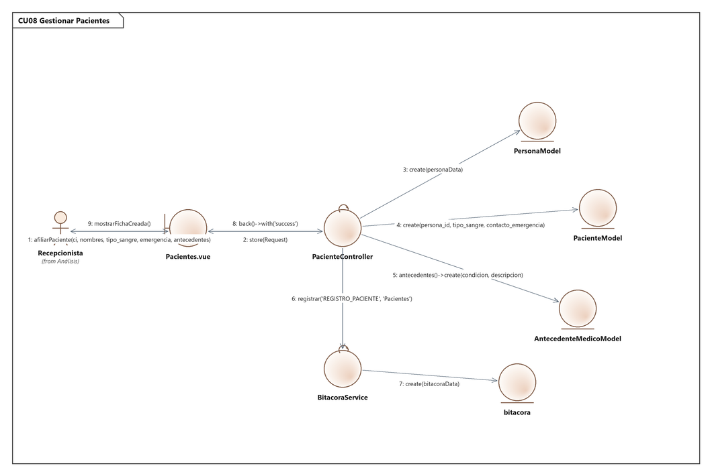
- **Actores:** `Recepcionista {from Análisis}`.
- **Frontera:** `Pacientes.vue` (`resources/js/Pages/Pacientes/Index.vue`).
- **Control:** `PacienteController`, `BitacoraService`.
- **Entidades:** `PersonaModel`, `PacienteModel`, `AntecedenteMedicoModel`, `bitacora`.
- **Trazabilidad de Código:**
  1. `afiliarPaciente()`: Registro de filiación, tipo de sangre, emergencia y antecedentes.
  2. `store(Request)`: `PacienteController@store` bajo transacción atómica.
  3. `create(personaData)`: Creación en superclase `personas`.
  4. `create(persona_id, tipo_sangre, ...) `: Alta clínica en `pacientes`.
  5. `antecedentes()->create(...)`: Registro patológico inicial en `antecedentes_medicos`.
  6. `registrar('REGISTRO_PACIENTE', 'Pacientes')`: Bitácora y feedback al usuario.

---

#### CU-09: Configurar Horarios Regulares de Atención
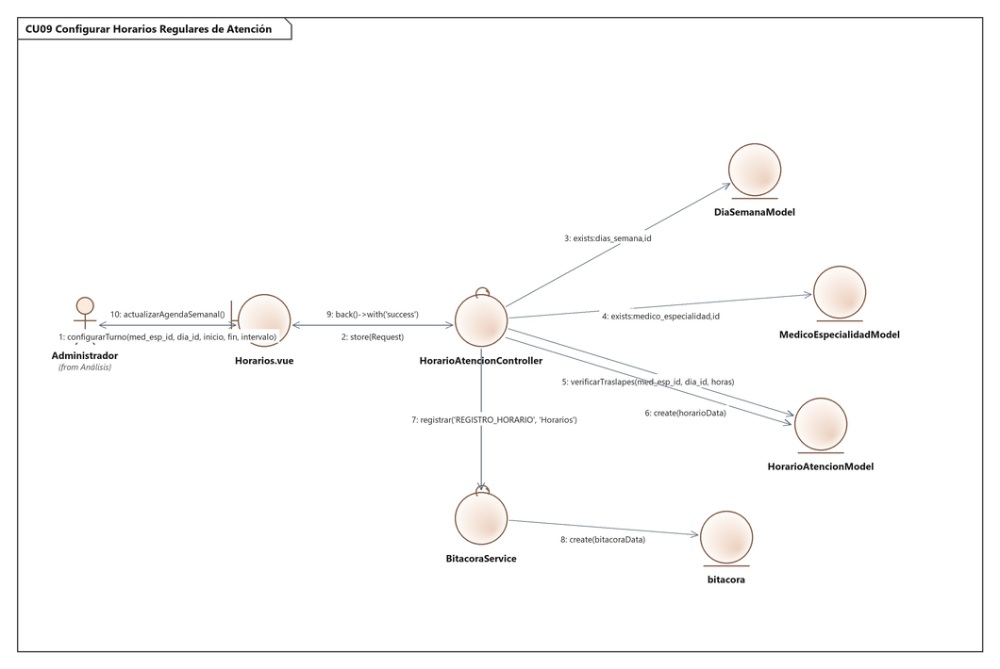
- **Actores:** `Administrador {from Análisis}`.
- **Frontera:** `Horarios.vue` (`resources/js/Pages/Horarios/Index.vue`).
- **Control:** `HorarioAtencionController`, `BitacoraService`.
- **Entidades:** `DiaSemanaModel`, `MedicoEspecialidadModel`, `HorarioAtencionModel`, `bitacora`.
- **Trazabilidad de Código:**
  1. `configurarTurno()`: Selección de médico, especialidad, día de la semana y franja horaria.
  2. `store(Request)`: Enrutado a `HorarioAtencionController@store`.
  3. `verificarTraslapes()`: Validación algorítmica para evitar colisión de franjas horarias en el mismo día.
  4. `create(horarioData)`: Inserción en `horarios_atencion`.
  5. `registrar('REGISTRO_HORARIO', 'Horarios')`: Bitácora y refresco de la grilla horaria.

---

#### CU-10: Gestionar Excepciones y Ausencias Médicas
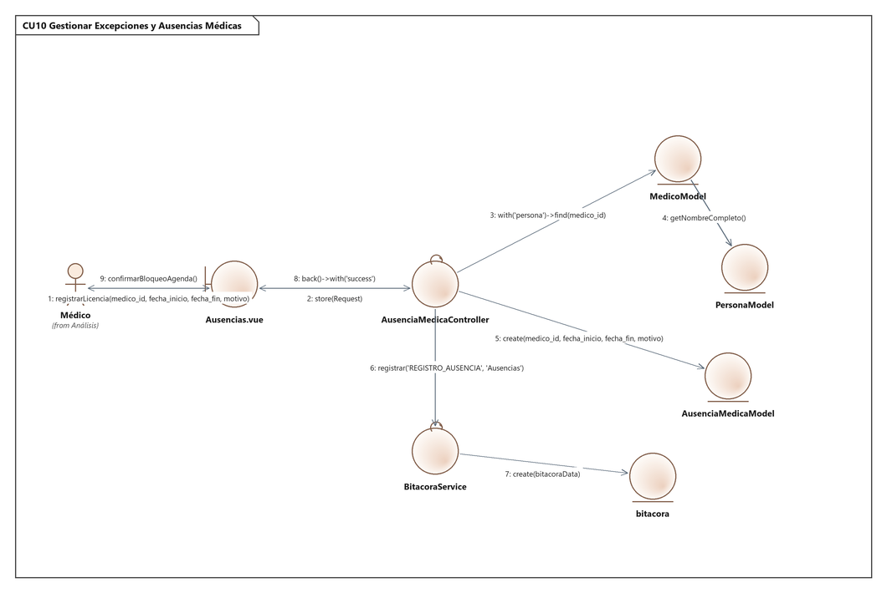
- **Actores:** `Médico {from Análisis}`.
- **Frontera:** `Ausencias.vue` (`resources/js/Pages/Ausencias/Index.vue`).
- **Control:** `AusenciaMedicaController`, `BitacoraService`.
- **Entidades:** `MedicoModel`, `PersonaModel`, `AusenciaMedicaModel`, `bitacora`.
- **Trazabilidad de Código:**
  1. `registrarLicencia()`: Solicitud de licencia por congreso, permiso o vacaciones.
  2. `store(Request)`: `AusenciaMedicaController@store`.
  3. `create(medico_id, fecha_inicio, fecha_fin, motivo)`: Registro en `ausencias_medicas`.
  4. `registrar('REGISTRO_AUSENCIA', 'Ausencias')`: Bitácora con fechas y motivo.
  5. Bloqueo inmediato del calendario de turnos para el profesional.

---

#### CU-11: Programar Cita Médica
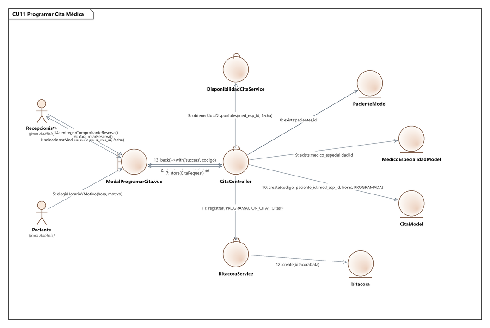
- **Actores:** `Recepcionista {from Análisis}`, `Paciente {from Análisis}`.
- **Frontera:** `ModalProgramarCita.vue` (`resources/js/Pages/Citas/Partials/ModalProgramarCita.vue`).
- **Control:** `CitaController`, `DisponibilidadCitaService`, `BitacoraService`.
- **Entidades:** `PacienteModel`, `MedicoEspecialidadModel`, `CitaModel`, `bitacora`.
- **Trazabilidad de Código:**
  1. `seleccionarMedicoFecha()`: El usuario elige especialidad, médico y fecha.
  2. `slots()`: Solicitud AJAX a `CitaController@slots`.
  3. `obtenerSlotsDisponibles()`: `DisponibilidadCitaService` evalúa horarios regulares, ausencias médicas y citas ocupadas.
  4. `elegirHorarioYMotivo()`: Selección del bloque libre.
  5. `store(CitaRequest)`: Persistencia de la cita con código único (`CIT-XXXX`).
  6. `create(...)`: Inserción en estado inicial `PROGRAMADA` (1).
  7. `registrar('PROGRAMACION_CITA', 'Citas')`: Registro en bitácora y emisión del código al paciente.

---

#### CU-12: Reprogramar Cita Médica
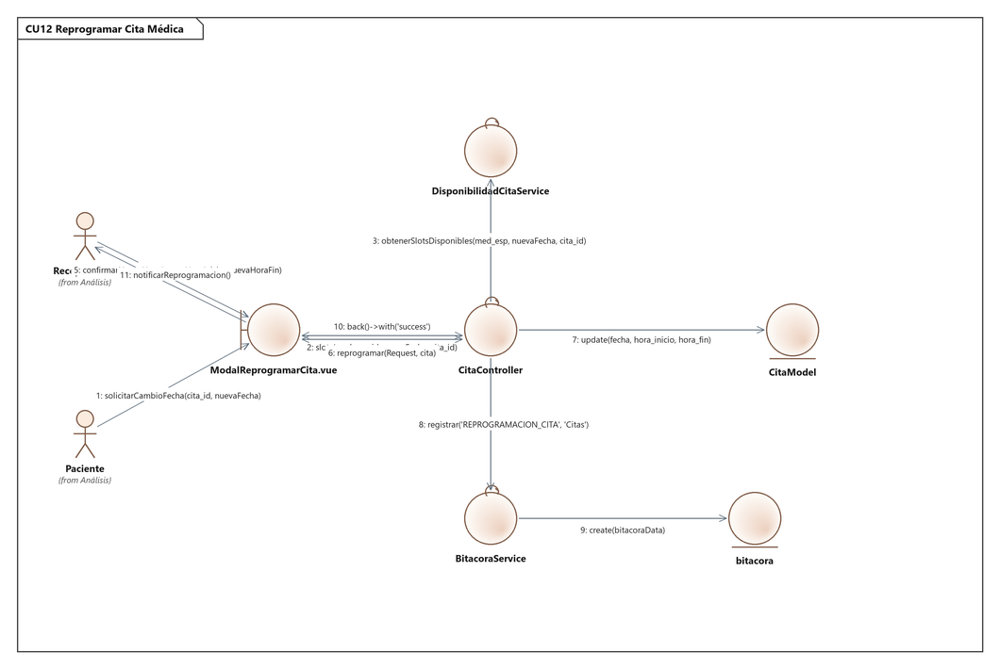
- **Actores:** `Recepcionista {from Análisis}`, `Paciente {from Análisis}`.
- **Frontera:** `ModalReprogramarCita.vue` (`resources/js/Pages/Citas/Partials/ModalReprogramarCita.vue`).
- **Control:** `CitaController`, `DisponibilidadCitaService`, `BitacoraService`.
- **Entidades:** `CitaModel`, `bitacora`.
- **Trazabilidad de Código:**
  1. `solicitarCambioFecha()`: Apertura de modal de reprogramación.
  2. `slots(...)`: Búsqueda de disponibilidad excluyendo la cita actual (`excluir_cita_id`).
  3. `reprogramar(Request, cita)`: Enrutado a `CitaController@reprogramar`.
  4. `update(fecha, hora_inicio, hora_fin)`: Actualización en `citas`.
  5. `registrar('REPROGRAMACION_CITA', 'Citas')`: Auditoría del cambio y confirmación.

---

#### CU-13: Cancelar Cita Médica
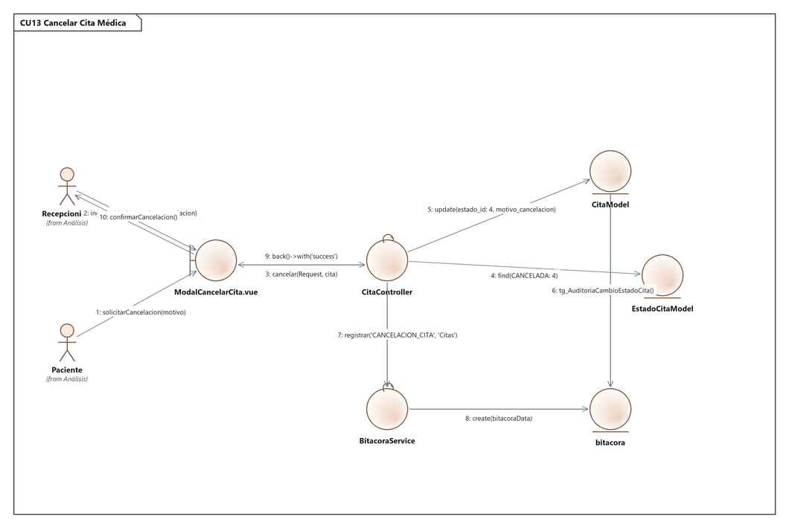
- **Actores:** `Recepcionista {from Análisis}`, `Paciente {from Análisis}`.
- **Frontera:** `ModalCancelarCita.vue` (`resources/js/Pages/Citas/Partials/ModalCancelarCita.vue`).
- **Control:** `CitaController`, `BitacoraService`.
- **Entidades:** `CitaModel`, `EstadoCitaModel`, `bitacora`.
- **Trazabilidad de Código:**
  1. `solicitarCancelacion()`: Solicitud de anulación de reserva.
  2. `cancelar(Request, cita)`: Invocación de `CitaController@cancelar`.
  3. `update(estado_id: CANCELADA, motivo_cancelacion)`: Actualización en `CitaModel`.
  4. `tg_AuditoriaCambioEstadoCita()`: Trigger de base de datos que audita el cambio de estado.
  5. `registrar('CANCELACION_CITA', 'Citas')`: Bitácora del sistema y confirmación al paciente.

---

#### CU-14: Registrar Atención de Paciente
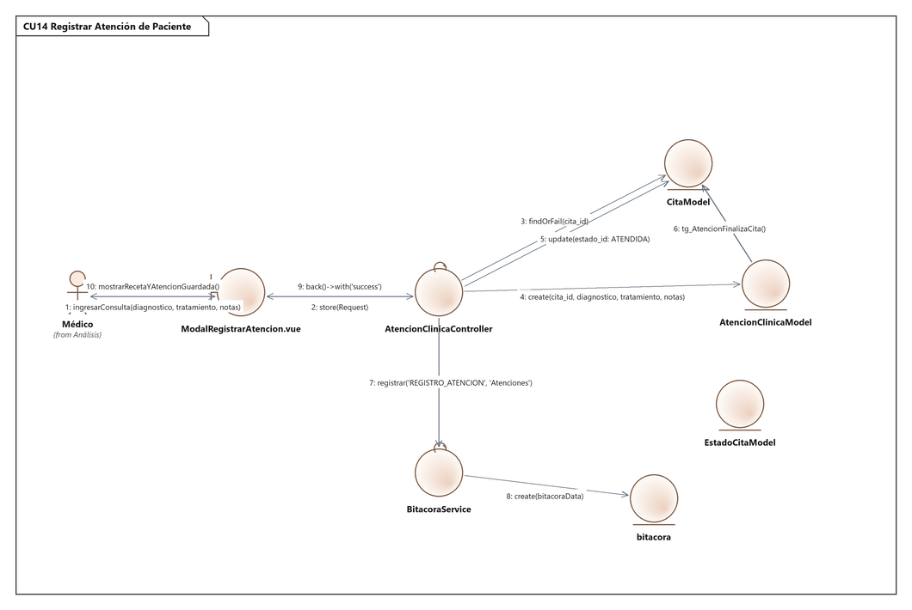
- **Actores:** `Médico {from Análisis}`.
- **Frontera:** `ModalRegistrarAtencion.vue` (`resources/js/Pages/Atenciones/Partials/ModalRegistrarAtencion.vue`).
- **Control:** `AtencionClinicaController`, `BitacoraService`.
- **Entidades:** `CitaModel`, `AtencionClinicaModel`, `EstadoCitaModel`, `bitacora`.
- **Trazabilidad de Código:**
  1. `ingresarConsulta()`: Llenado de diagnóstico clínico, tratamiento farmacológico y notas.
  2. `store(Request)`: Enrutado a `AtencionClinicaController@store`.
  3. `create(cita_id, diagnostico, tratamiento, notas)`: Inserción en `atenciones_clinicas`.
  4. `update(estado_id: ATENDIDA)`: Cierre de la cita médica a estado 3 (*Atendida*).
  5. `tg_AtencionFinalizaCita()`: Trigger de base de datos de integridad clínica.
  6. `registrar('REGISTRO_ATENCION', 'Atenciones')`: Auditoría y generación de receta para el paciente.

---

#### CU-15: Consultar Historial de Citas
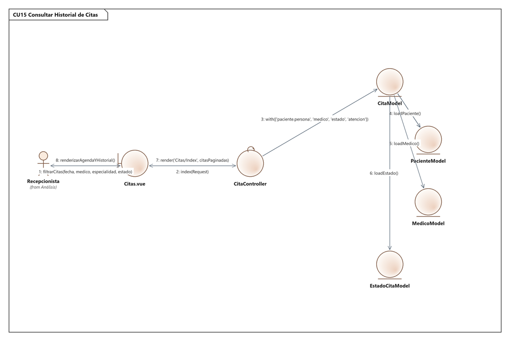
- **Actores:** `Recepcionista {from Análisis}`.
- **Frontera:** `Citas.vue` (`resources/js/Pages/Citas/Index.vue`).
- **Control:** `CitaController`.
- **Entidades:** `CitaModel`, `PacienteModel`, `MedicoModel`, `EstadoCitaModel`.
- **Trazabilidad de Código:**
  1. `filtrarCitas()`: Búsqueda avanzada por fecha, estado de cita, médico y paciente.
  2. `index(Request)`: Enrutado a `CitaController@index`.
  3. `with(['paciente.persona', 'medico', 'estado', 'atencion'])`: Carga completa de relaciones.
  4. `render('Citas/Index', citasPaginadas)`: Despliegue en la interfaz de la agenda de citas y badges de estado.

---

#### CU-16: Generar Reportes Administrativos
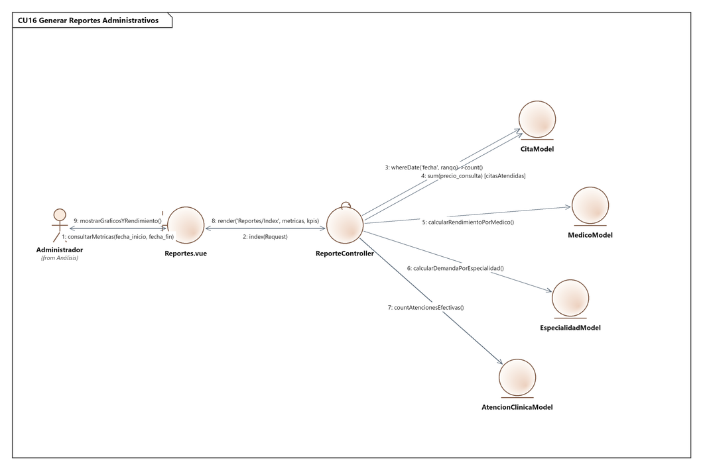
- **Actores:** `Administrador {from Análisis}`.
- **Frontera:** `Reportes.vue` (`resources/js/Pages/Reportes/Index.vue`).
- **Control:** `ReporteController`.
- **Entidades:** `CitaModel`, `MedicoModel`, `EspecialidadModel`, `AtencionClinicaModel`.
- **Trazabilidad de Código:**
  1. `consultarMetricas()`: Selección del rango de análisis mensual o anual.
  2. `index(Request)`: `ReporteController@index`.
  3. `whereDate('fecha', rango)->count()`: Conteo de citas totales, atendidas y canceladas.
  4. `sum(precio_consulta)`: Cálculo de recaudación acumulada por aranceles médicos.
  5. `calcularRendimientoPorMedico()`: Productividad y porcentaje de cumplimiento por profesional.
  6. `calcularDemandaPorEspecialidad()`: Análisis de especialidades médicas más solicitadas.
  7. `render('Reportes/Index', metricas, kpis)`: Visualización de gráficos y tarjetas KPI.

---

#### CU-17: Exportar Datos a .xlsx
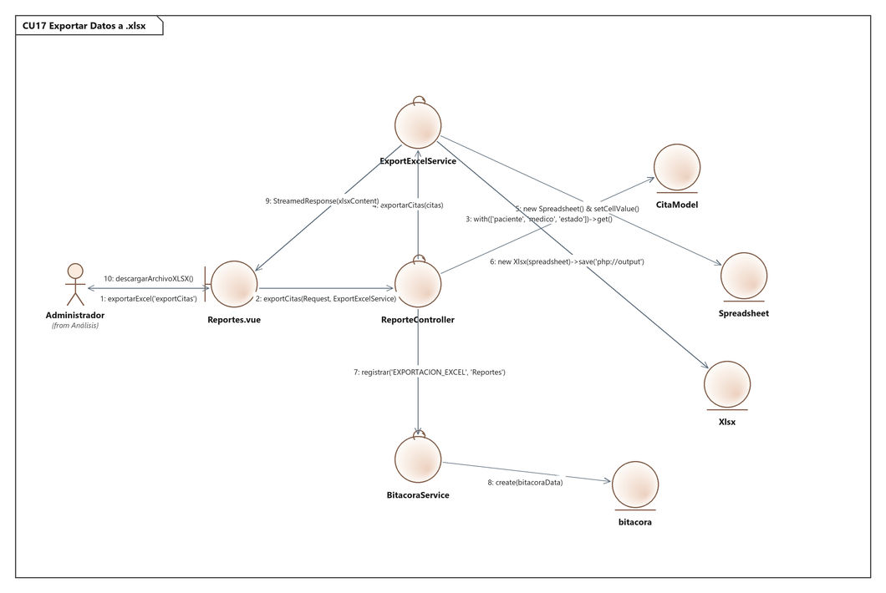
- **Actores:** `Administrador {from Análisis}`.
- **Frontera:** `Reportes.vue` (`resources/js/Pages/Reportes/Index.vue`).
- **Control:** `ReporteController`, `ExportExcelService`, `BitacoraService`.
- **Entidades:** `CitaModel`, `Spreadsheet`, `Xlsx`, `bitacora`.
- **Trazabilidad de Código:**
  1. `exportarExcel('exportCitas')`: Clic en botón de exportación a hoja de cálculo.
  2. `exportCitas(Request, ExportExcelService)`: `ReporteController@exportCitas`.
  3. `with(['paciente', 'medico', 'estado'])->get()`: Extracción de registros de `citas`.
  4. `exportarCitas(citas)`: Invocación en `ExportExcelService`.
  5. `new Spreadsheet()`: Creación de libro y aplicación de estilos corporativos (encabezados Navy `#0F172A`, bordes y anchos automáticos).
  6. `new Xlsx(spreadsheet)->save('php://output')`: Generación binaria nativa.
  7. `registrar('EXPORTACION_EXCEL', 'Reportes')`: Auditoría del evento de descarga.
  8. `StreamedResponse(xlsx)`: Descarga directa del archivo `.xlsx` en el navegador del usuario.
