# Diagramas de Secuencia UML
## Sistema de Información para la Gestión, Programación y Control de Citas Médicas - Clínica Vida Salud
**Universidad Autónoma Gabriel René Moreno (UAGRM) — Facultad de Ingeniería en Ciencias de la Computación y Telecomunicaciones**
**Grupo #25**

---

### 1. Marco Metodológico y Estructura Arquitectónica

Siguiendo el estándar del **Proceso Unificado de Desarrollo de Software (PUDS / RUP)** y la especificación de UML 2.5 (alineado con herramientas CASE como Enterprise Architect y Visual Paradigm), los **Diagramas de Secuencia** modelan la interacción temporal y la colaboración entre los actores y los componentes del sistema organizados bajo el patrón **Modelo - Vista - Controlador (MVC)**:

1. **Marco de Diagrama (`sd <Identificador>`):** Marco exterior formal con pestaña poligonal de corte diagonal superior izquierda con el nombre del caso de uso.
2. **Actor (`: NombreActor`):** Usuario que inicia la interacción en el sistema (`Administrador`, `Recepcionista`, `Médico`, `Paciente`). Se representa con el símbolo de actor UML y su línea de vida correspondiente.
3. **Líneas de Vida (`Lifeline`):** Ejes verticales segmentados que representan la existencia del objeto a lo largo del tiempo.
   - **Capa Vista / Frontera (`Vista_*`):** Componentes visuales y páginas reactivas desarrolladas en Vue 3 / Inertia.js.
   - **Capa Controlador / Control (`Controller_*`):** Controladores de backend de Laravel 12 y servicios de negocio encargados de procesar y validar las transacciones.
   - **Capa Modelo / Entidad (`Entidad`):** Modelos Eloquent de Laravel y tablas relacionales en PostgreSQL.
   - **Auditoría / Servicios Transversales (`Bitacora` / `BaseDeDatos` / `ExportExcelService`):** Persistencia de trazabilidad y utilitarios del sistema.
4. **Focos de Control / Barras de Activación (`Activation Bars`):** Rectángulos delgados verticales sobre la línea de vida que denotan el periodo durante el cual un objeto ejecuta una operación.
5. **Mensajes Conceptuales Numerados (`n : NombreMensaje`):** Flechas dirigidas horizontales sin sintaxis de bajo nivel ni código fuente crudo, expresando con claridad las acciones del caso de uso organizadas en tres bloques operativos estructurados (Consulta, Registro/Ejecución, Modificación/Gestión).

---

### 2. Catálogo Maestro de los 17 Diagramas de Secuencia

| Caso de Uso | Título | Actor Principal | Componentes y Líneas de Vida | Archivo de Imagen Generado |
| :---: | :--- | :--- | :--- | :--- |
| **CU-01** | Gestionar Usuarios | `: Administrador` | `Vista_Usuario`, `Controller_Usuario`, `Usuario`, `Bitacora` | [`docs/diagramas/secuencia/CU01_Gestionar_Usuarios.png`](./secuencia/CU01_Gestionar_Usuarios.png) |
| **CU-02** | Gestionar Roles y Permisos | `: Administrador` | `Vista_Rol`, `Controller_Rol`, `Rol`, `Permiso` | [`docs/diagramas/secuencia/CU02_Gestionar_Roles_Permisos.png`](./secuencia/CU02_Gestionar_Roles_Permisos.png) |
| **CU-03** | Consultar Bitácora de Auditoría | `: Administrador` | `Vista_Bitacora`, `Controller_Bitacora`, `Bitacora` | [`docs/diagramas/secuencia/CU03_Consultar_Bitacora.png`](./secuencia/CU03_Consultar_Bitacora.png) |
| **CU-04** | Gestionar Respaldos de Base de Datos | `: Administrador` | `Vista_Respaldo`, `Controller_Backup`, `BaseDeDatos`, `Bitacora` | [`docs/diagramas/secuencia/CU04_Gestionar_Respaldos.png`](./secuencia/CU04_Gestionar_Respaldos.png) |
| **CU-05** | Gestionar Especialidades | `: Administrador` | `Vista_Especialidad`, `Controller_Especialidad`, `Especialidad` | [`docs/diagramas/secuencia/CU05_Gestionar_Especialidades.png`](./secuencia/CU05_Gestionar_Especialidades.png) |
| **CU-06** | Gestionar Médicos | `: Administrador` | `Vista_Medico`, `Controller_Medico`, `Medico`, `Especialidad` | [`docs/diagramas/secuencia/CU06_Gestionar_Medicos.png`](./secuencia/CU06_Gestionar_Medicos.png) |
| **CU-07** | Gestionar Perfil Médico Base | `: Médico` | `Vista_PerfilMedico`, `Controller_PerfilMedico`, `Medico` | [`docs/diagramas/secuencia/CU07_Gestionar_Perfil_Medico.png`](./secuencia/CU07_Gestionar_Perfil_Medico.png) |
| **CU-08** | Gestionar Pacientes | `: Recepcionista` | `Vista_Paciente`, `Controller_Paciente`, `Paciente` | [`docs/diagramas/secuencia/CU08_Gestionar_Pacientes.png`](./secuencia/CU08_Gestionar_Pacientes.png) |
| **CU-09** | Configurar Horarios Regulares de Atención | `: Administrador` | `Vista_Horario`, `Controller_Horario`, `HorarioAtencion` | [`docs/diagramas/secuencia/CU09_Configurar_Horarios.png`](./secuencia/CU09_Configurar_Horarios.png) |
| **CU-10** | Gestionar Excepciones y Ausencias Médicas | `: Médico` | `Vista_Ausencia`, `Controller_Ausencia`, `AusenciaMedica` | [`docs/diagramas/secuencia/CU10_Gestionar_Ausencias_Medicas.png`](./secuencia/CU10_Gestionar_Ausencias_Medicas.png) |
| **CU-11** | Programar Cita Médica | `: Recepcionista` | `Vista_Cita`, `Controller_Cita`, `Disponibilidad`, `Cita` | [`docs/diagramas/secuencia/CU11_Programar_Cita_Medica.png`](./secuencia/CU11_Programar_Cita_Medica.png) |
| **CU-12** | Reprogramar Cita Médica | `: Recepcionista` | `Vista_Cita`, `Controller_Cita`, `Disponibilidad`, `Cita` | [`docs/diagramas/secuencia/CU12_Reprogramar_Cita_Medica.png`](./secuencia/CU12_Reprogramar_Cita_Medica.png) |
| **CU-13** | Cancelar Cita Médica | `: Recepcionista` | `Vista_Cita`, `Controller_Cita`, `Cita`, `Bitacora` | [`docs/diagramas/secuencia/CU13_Cancelar_Cita_Medica.png`](./secuencia/CU13_Cancelar_Cita_Medica.png) |
| **CU-14** | Registrar Atención de Paciente | `: Médico` | `Vista_Atencion`, `Controller_Atencion`, `AtencionClinica`, `Cita` | [`docs/diagramas/secuencia/CU14_Registrar_Atencion_Paciente.png`](./secuencia/CU14_Registrar_Atencion_Paciente.png) |
| **CU-15** | Consultar Historial de Citas | `: Recepcionista` | `Vista_Historial`, `Controller_Cita`, `Cita`, `Paciente` | [`docs/diagramas/secuencia/CU15_Consultar_Historial_Citas.png`](./secuencia/CU15_Consultar_Historial_Citas.png) |
| **CU-16** | Generar Reportes Administrativos | `: Administrador` | `Vista_Reporte`, `Controller_Reporte`, `Reporte` | [`docs/diagramas/secuencia/CU16_Generar_Reportes_Administrativos.png`](./secuencia/CU16_Generar_Reportes_Administrativos.png) |
| **CU-17** | Exportar Datos a .xlsx | `: Administrador` | `Vista_Exportar`, `Controller_Reporte`, `ExportExcelService`, `Bitacora` | [`docs/diagramas/secuencia/CU17_Exportar_Datos_XLSX.png`](./secuencia/CU17_Exportar_Datos_XLSX.png) |

---

### 3. Especificación Detallada de los 17 Diagramas de Secuencia

---

#### CU-01: Gestionar Usuarios
Modela la administración integral de cuentas de usuario: consulta, creación de nueva cuenta y desactivación/modificación de estado con registro de auditoría.

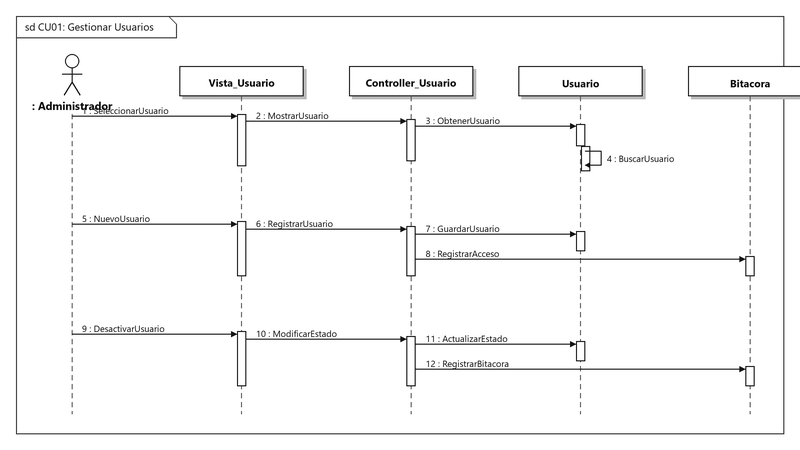

- **Actor:** `: Administrador`
- **Líneas de Vida:** `Vista_Usuario`, `Controller_Usuario`, `Usuario`, `Bitacora`
- **Mensajes:**
  - *Bloque 1 (Consulta de Usuario):*
    1. `1 : SeleccionarUsuario`: Solicitud desde la interfaz de administración.
    2. `2 : MostrarUsuario`: Reenvío de la solicitud al controlador.
    3. `3 : ObtenerUsuario`: Consulta al modelo de datos.
    4. `4 : BuscarUsuario`: Búsqueda interna y armado de la lista de usuarios.
  - *Bloque 2 (Registro de Usuario):*
    5. `5 : NuevoUsuario`: Envío del formulario de registro.
    6. `6 : RegistrarUsuario`: Procesamiento de datos en el controlador.
    7. `7 : GuardarUsuario`: Persistencia de la cuenta y sus credenciales.
    8. `8 : RegistrarAcceso`: Registro del evento en bitácora.
  - *Bloque 3 (Desactivar / Modificar Usuario):*
    9. `9 : DesactivarUsuario`: Solicitud de cambio de estado.
    10. `10 : ModificarEstado`: Petición de actualización en el controlador.
    11. `11 : ActualizarEstado`: Desactivación lógica de la cuenta.
    12. `12 : RegistrarBitacora`: Auditoría inmutable de la acción.

---

#### CU-02: Gestionar Roles y Permisos
Modela el control de acceso basado en roles (RBAC): consulta de matriz de permisos, creación de roles y sincronización de privilegios.

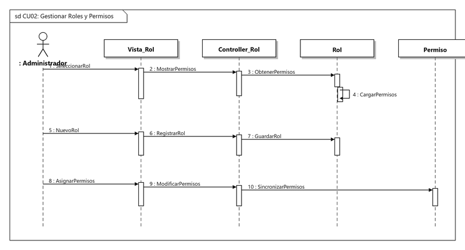

- **Actor:** `: Administrador`
- **Líneas de Vida:** `Vista_Rol`, `Controller_Rol`, `Rol`, `Permiso`
- **Mensajes:**
  - *Bloque 1 (Consulta de Permisos):*
    1. `1 : SeleccionarRol`: Apertura de la matriz de roles y permisos.
    2. `2 : MostrarPermisos`: Reenvío al controlador de roles.
    3. `3 : ObtenerPermisos`: Consulta de permisos asociados al rol.
    4. `4 : CargarPermisos`: Lectura interna del catálogo de permisos.
  - *Bloque 2 (Nuevo Rol):*
    5. `5 : NuevoRol`: Envío del nombre y descripción del nuevo rol.
    6. `6 : RegistrarRol`: Validación y preparación en el controlador.
    7. `7 : GuardarRol`: Creación del registro en el modelo.
  - *Bloque 3 (Asignar y Modificar Permisos):*
    8. `8 : AsignarPermisos`: Marcado de la matriz de permisos.
    9. `9 : ModificarPermisos`: Petición de actualización de privilegios.
    10. `10 : SincronizarPermisos`: Vinculación de permisos asignados al rol.

---

#### CU-03: Consultar Bitácora de Auditoría
Modela la inspección inmutable de eventos del sistema, consulta de transacciones y visualización de registros técnicos del servidor.

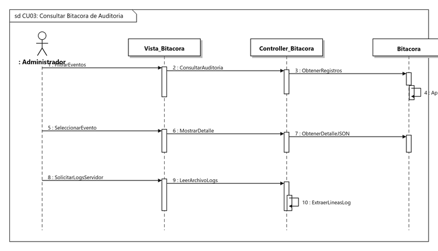

- **Actor:** `: Administrador`
- **Líneas de Vida:** `Vista_Bitacora`, `Controller_Bitacora`, `Bitacora`
- **Mensajes:**
  - *Bloque 1 (Filtrar Eventos):*
    1. `1 : FiltrarEventos`: Ingreso de parámetros de búsqueda (fecha, usuario, módulo).
    2. `2 : ConsultarAuditoria`: Petición de registros al controlador.
    3. `3 : ObtenerRegistros`: Extracción de tuplas desde el modelo `Bitacora`.
    4. `4 : AplicarFiltros`: Búsqueda y ordenamiento cronológico interno.
  - *Bloque 2 (Detalle del Evento):*
    5. `5 : SeleccionarEvento`: Selección de una transacción para inspección.
    6. `6 : MostrarDetalle`: Petición de carga de datos detallados.
    7. `7 : ObtenerDetalleJSON`: Extracción del payload con valores previos y nuevos.
  - *Bloque 3 (Logs del Servidor):*
    8. `8 : SolicitarLogsServidor`: Petición de lectura técnica de logs.
    9. `9 : LeerArchivoLogs`: Lectura del archivo de registro del framework.
    10. `10 : ExtraerLineasLog`: Parseo y formateo de líneas de error o advertencia.

---

#### CU-04: Gestionar Respaldos de Base de Datos
Modela la verificación del estado de la base de datos, generación y descarga de copias SQL y validación de respaldos.

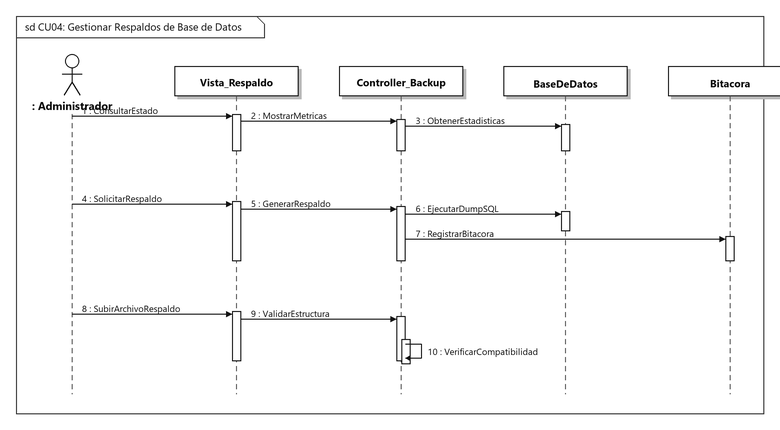

- **Actor:** `: Administrador`
- **Líneas de Vida:** `Vista_Respaldo`, `Controller_Backup`, `BaseDeDatos`, `Bitacora`
- **Mensajes:**
  - *Bloque 1 (Consultar Estado):*
    1. `1 : ConsultarEstado`: Acceso a la vista de respaldos.
    2. `2 : MostrarMetricas`: Consulta de métricas de almacenamiento.
    3. `3 : ObtenerEstadisticas`: Consulta del tamaño y tablas de la BD.
  - *Bloque 2 (Generar y Descargar Respaldo):*
    4. `4 : SolicitarRespaldo`: Clic en generación de copia de seguridad.
    5. `5 : GenerarRespaldo`: Inicio del proceso de volcado en el controlador.
    6. `6 : EjecutarDumpSQL`: Extracción del esquema y datos en formato SQL.
    7. `7 : RegistrarBitacora`: Asentamiento de la copia generada.
  - *Bloque 3 (Verificar Integridad):*
    8. `8 : SubirArchivoRespaldo`: Carga del archivo `.sql` para verificación.
    9. `9 : ValidarEstructura`: Comprobación sintáctica del respaldo.
    10. `10 : VerificarCompatibilidad`: Verificación de versiones y esquemas.

---

#### CU-05: Gestionar Especialidades
Modela la administración del catálogo de especialidades médicas (Cardiología, Pediatría, Medicina General, etc.).

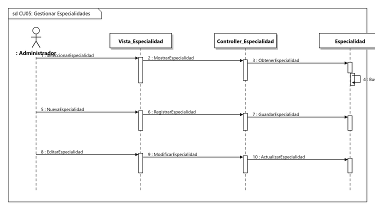

- **Actor:** `: Administrador`
- **Líneas de Vida:** `Vista_Especialidad`, `Controller_Especialidad`, `Especialidad`
- **Mensajes:**
  - *Bloque 1 (Consulta de Especialidades):*
    1. `1 : SeleccionarEspecialidad`: Búsqueda o selección en el listado.
    2. `2 : MostrarEspecialidad`: Solicitud al controlador.
    3. `3 : ObtenerEspecialidad`: Consulta al modelo.
    4. `4 : BuscarEspecialidad`: Lectura de registros activos.
  - *Bloque 2 (Nueva Especialidad):*
    5. `5 : NuevaEspecialidad`: Formulario con nombre y descripción.
    6. `6 : RegistrarEspecialidad`: Validación de unicidad en el controlador.
    7. `7 : GuardarEspecialidad`: Persistencia en la tabla `especialidades`.
  - *Bloque 3 (Editar Especialidad):*
    8. `8 : EditarEspecialidad`: Selección de especialidad a modificar.
    9. `9 : ModificarEspecialidad`: Envío de datos actualizados.
    10. `10 : ActualizarEspecialidad`: Guardado de cambios en la base de datos.

---

#### CU-06: Gestionar Médicos
Modela el alta de profesionales de la salud, asignación de matrícula profesional y vinculación de especialidades.

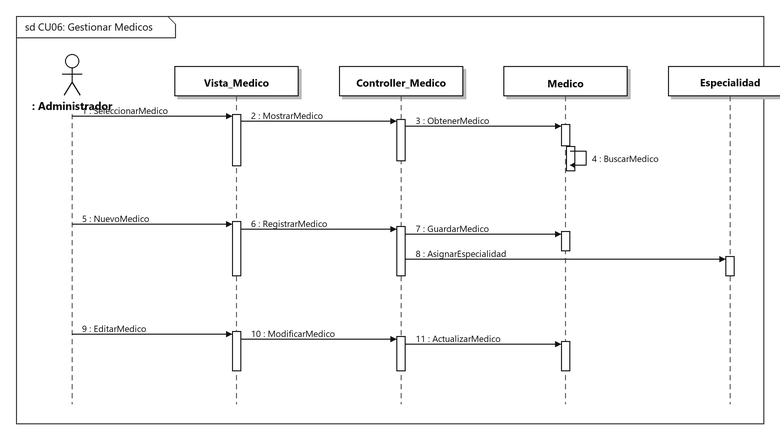

- **Actor:** `: Administrador`
- **Líneas de Vida:** `Vista_Medico`, `Controller_Medico`, `Medico`, `Especialidad`
- **Mensajes:**
  - *Bloque 1 (Consulta de Médicos):*
    1. `1 : SeleccionarMedico`: Visualización del equipo médico.
    2. `2 : MostrarMedico`: Consulta al controlador de médicos.
    3. `3 : ObtenerMedico`: Extracción de datos del profesional.
    4. `4 : BuscarMedico`: Carga de información y estado.
  - *Bloque 2 (Registrar Médico):*
    5. `5 : NuevoMedico`: Envío de datos personales y matrícula.
    6. `6 : RegistrarMedico`: Creación del profesional de salud.
    7. `7 : GuardarMedico`: Persistencia en el modelo `Medico`.
    8. `8 : AsignarEspecialidad`: Vinculación con la especialidad médica.
  - *Bloque 3 (Editar Médico):*
    9. `9 : EditarMedico`: Selección del médico para actualización.
    10. `10 : ModificarMedico`: Envío de datos actualizados.
    11. `11 : ActualizarMedico`: Persistencia de cambios.

---

#### CU-07: Gestionar Perfil Médico Base
Modela la autogestión de perfil profesional por parte del médico (biografía, consultorio y tarifa de consulta).

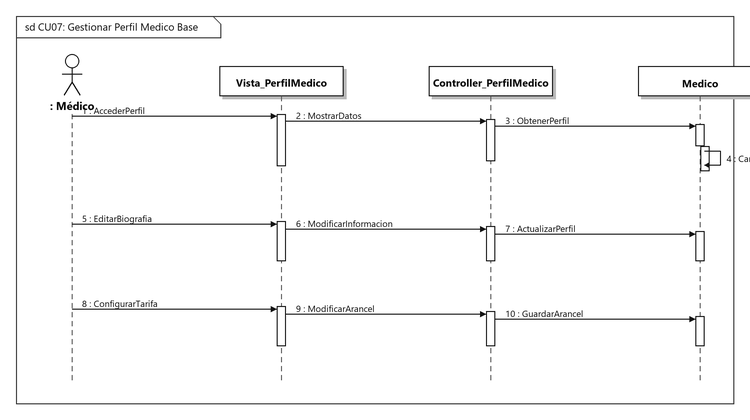

- **Actor:** `: Médico`
- **Líneas de Vida:** `Vista_PerfilMedico`, `Controller_PerfilMedico`, `Medico`
- **Mensajes:**
  - *Bloque 1 (Acceso a Perfil):*
    1. `1 : AccederPerfil`: El médico entra a la sección de su perfil.
    2. `2 : MostrarDatos`: Solicitud de carga al controlador.
    3. `3 : ObtenerPerfil`: Consulta de datos del médico autenticado.
    4. `4 : CargarDatosMedicos`: Preparación de información profesional.
  - *Bloque 2 (Editar Biografía e Información):*
    5. `5 : EditarBiografia`: Modificación de datos profesionales.
    6. `6 : ModificarInformacion`: Envío de campos al controlador.
    7. `7 : ActualizarPerfil`: Persistencia de los cambios en el modelo.
  - *Bloque 3 (Configurar Tarifa y Consultorio):*
    8. `8 : ConfigurarTarifa`: Actualización del arancel de consulta.
    9. `9 : ModificarArancel`: Procesamiento en el controlador.
    10. `10 : GuardarArancel`: Actualización de la tarifa y consultorio.

---

#### CU-08: Gestionar Pacientes
Modela la administración clínica de pacientes (consulta, registro clínico básico y actualización de datos).

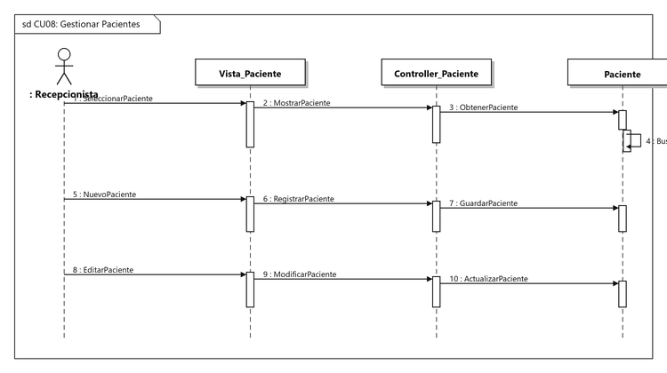

- **Actor:** `: Recepcionista`
- **Líneas de Vida:** `Vista_Paciente`, `Controller_Paciente`, `Paciente`
- **Mensajes:**
  - *Bloque 1 (Consulta de Paciente):*
    1. `1 : SeleccionarPaciente`: Búsqueda por CI o nombres.
    2. `2 : MostrarPaciente`: Consulta al controlador.
    3. `3 : ObtenerPaciente`: Extracción del expediente.
    4. `4 : BuscarPaciente`: Filtrado interno de coincidencias.
  - *Bloque 2 (Nuevo Paciente):*
    5. `5 : NuevoPaciente`: Admisión de nuevo paciente.
    6. `6 : RegistrarPaciente`: Procesamiento de datos personales y clínicos.
    7. `7 : GuardarPaciente`: Creación del registro en el modelo `Paciente`.
  - *Bloque 3 (Editar Paciente):*
    8. `8 : EditarPaciente`: Selección de paciente existente.
    9. `9 : ModificarPaciente`: Envío de datos actualizados.
    10. `10 : ActualizarPaciente`: Guardado en base de datos.

---

#### CU-09: Configurar Horarios Regulares de Atención
Modela la planificación semanal de turnos de atención médica y prevención de solapamientos.

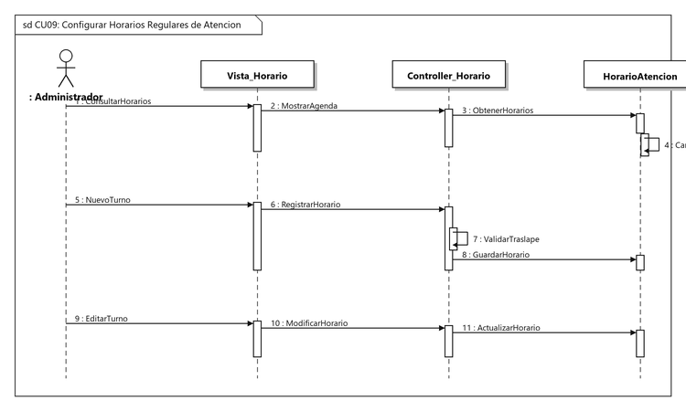

- **Actor:** `: Administrador`
- **Líneas de Vida:** `Vista_Horario`, `Controller_Horario`, `HorarioAtencion`
- **Mensajes:**
  - *Bloque 1 (Consultar Agenda Semanal):*
    1. `1 : ConsultarHorarios`: Selección de médico y día.
    2. `2 : MostrarAgenda`: Solicitud al controlador.
    3. `3 : ObtenerHorarios`: Carga de turnos configurados.
    4. `4 : CargarTurnos`: Organización de intervalos por día.
  - *Bloque 2 (Nuevo Turno):*
    5. `5 : NuevoTurno`: Definición de horario de inicio y fin.
    6. `6 : RegistrarHorario`: Procesamiento del bloque de atención.
    7. `7 : ValidarTraslape`: Verificación de no colisión temporal.
    8. `8 : GuardarHorario`: Persistencia en `HorarioAtencion`.
  - *Bloque 3 (Editar Turno):*
    9. `9 : EditarTurno`: Ajuste de horario de atención.
    10. `10 : ModificarHorario`: Envío de nuevo intervalo.
    11. `11 : ActualizarHorario`: Actualización del registro.

---

#### CU-10: Gestionar Excepciones y Ausencias Médicas
Modela el registro de ausencias, permisos, licencias o vacaciones médicas con bloqueo automático de agenda.

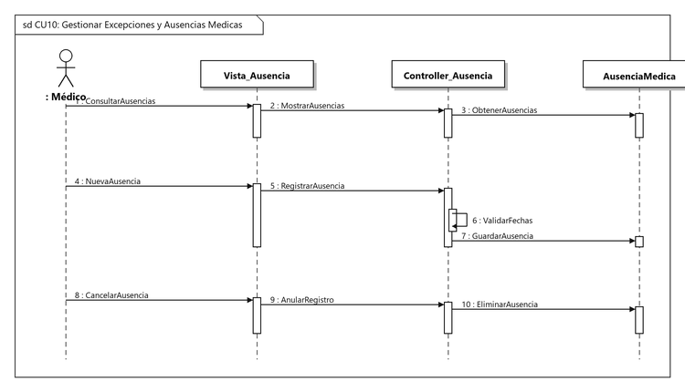

- **Actor:** `: Médico`
- **Líneas de Vida:** `Vista_Ausencia`, `Controller_Ausencia`, `AusenciaMedica`
- **Mensajes:**
  - *Bloque 1 (Consultar Ausencias):*
    1. `1 : ConsultarAusencias`: Visualización de licencias programadas.
    2. `2 : MostrarAusencias`: Solicitud de listado al controlador.
    3. `3 : ObtenerAusencias`: Consulta de fechas de ausencia del médico.
  - *Bloque 2 (Registrar Ausencia):*
    4. `4 : NuevaAusencia`: Envío de fechas de inicio, fin y motivo.
    5. `5 : RegistrarAusencia`: Procesamiento en el controlador.
    6. `6 : ValidarFechas`: Comprobación de coherencia cronológica.
    7. `7 : GuardarAusencia`: Creación del registro en `AusenciaMedica`.
  - *Bloque 3 (Cancelar Ausencia):*
    8. `8 : CancelarAusencia`: Selección de ausencia a anular.
    9. `9 : AnularRegistro`: Petición de baja al controlador.
    10. `10 : EliminarAusencia`: Eliminación y liberación de turnos.

---

#### CU-11: Programar Cita Médica
Modela la consulta de disponibilidad en tiempo real, reserva de turno y generación de código único de cita.

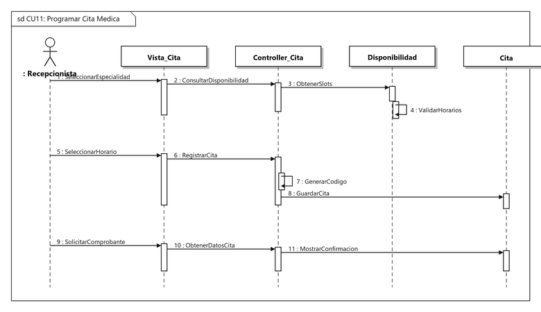

- **Actor:** `: Recepcionista`
- **Líneas de Vida:** `Vista_Cita`, `Controller_Cita`, `Disponibilidad`, `Cita`
- **Mensajes:**
  - *Bloque 1 (Consultar Disponibilidad):*
    1. `1 : SeleccionarEspecialidad`: Elección de especialidad, médico y fecha.
    2. `2 : ConsultarDisponibilidad`: Petición de horarios libres.
    3. `3 : ObtenerSlots`: Invocación al servicio de disponibilidad.
    4. `4 : ValidarHorarios`: Descarte de horas ocupadas y ausencias.
  - *Bloque 2 (Reservar Cita):*
    5. `5 : SeleccionarHorario`: Confirmación del turno con el paciente.
    6. `6 : RegistrarCita`: Envío de datos de la reserva.
    7. `7 : GenerarCodigo`: Asignación del código único (`CIT-XXXX`).
    8. `8 : GuardarCita`: Persistencia en estado `PROGRAMADA`.
  - *Bloque 3 (Emitir Comprobante):*
    9. `9 : SolicitarComprobante`: Emisión del ticket de cita.
    10. `10 : ObtenerDatosCita`: Carga de detalles de la reserva.
    11. `11 : MostrarConfirmacion`: Presentación de comprobante en pantalla.

---

#### CU-12: Reprogramar Cita Médica
Modela el cambio de fecha u hora de una cita ya programada con validación de nueva disponibilidad.

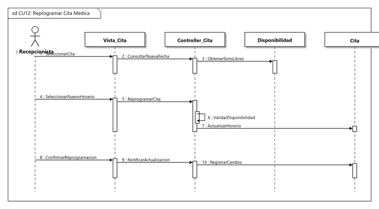

- **Actor:** `: Recepcionista`
- **Líneas de Vida:** `Vista_Cita`, `Controller_Cita`, `Disponibilidad`, `Cita`
- **Mensajes:**
  - *Bloque 1 (Consultar Nueva Fecha):*
    1. `1 : SeleccionarCita`: Búsqueda de la cita a reprogramar.
    2. `2 : ConsultarNuevaFecha`: Solicitud de horarios para la nueva fecha.
    3. `3 : ObtenerSlotsLibres`: Consulta al servicio excluyendo la cita actual.
  - *Bloque 2 (Confirmar Reprogramación):*
    4. `4 : SeleccionarNuevoHorario`: Elección del nuevo slot disponible.
    5. `5 : ReprogramarCita`: Solicitud de modificación al controlador.
    6. `6 : ValidarDisponibilidad`: Comprobación final de turno libre.
    7. `7 : ActualizarHorario`: Actualización de fecha y hora en `Cita`.
  - *Bloque 3 (Registrar Cambio):*
    8. `8 : ConfirmarReprogramacion`: Notificación de cambio aceptado.
    9. `9 : NotificarActualizacion`: Registro del evento en el controlador.
    10. `10 : RegistrarCambio`: Auditoría de la fecha anterior y nueva.

---

#### CU-13: Cancelar Cita Médica
Modela la anulación formal de una cita médica exigiendo motivo de cancelación y liberando el turno.

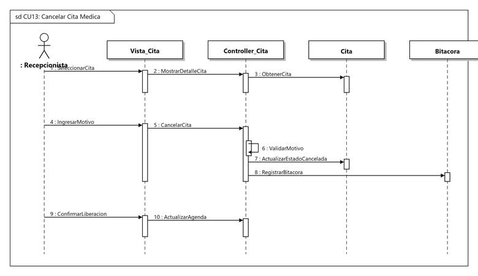

- **Actor:** `: Recepcionista`
- **Líneas de Vida:** `Vista_Cita`, `Controller_Cita`, `Cita`, `Bitacora`
- **Mensajes:**
  - *Bloque 1 (Seleccionar Cita a Cancelar):*
    1. `1 : SeleccionarCita`: Localización de la reserva en el sistema.
    2. `2 : MostrarDetalleCita`: Visualización de los datos actuales.
    3. `3 : ObtenerCita`: Carga desde el modelo `Cita`.
  - *Bloque 2 (Registrar Motivo y Cancelar):*
    4. `4 : IngresarMotivo`: Captura de la justificación clínica u operativa.
    5. `5 : CancelarCita`: Petición de anulación en el controlador.
    6. `6 : ValidarMotivo`: Comprobación de longitud y contenido.
    7. `7 : ActualizarEstadoCancelada`: Cambio a estado `CANCELADA`.
    8. `8 : RegistrarBitacora`: Registro inmutable de la anulación.
  - *Bloque 3 (Liberar Turno):*
    9. `9 : ConfirmarLiberacion`: Confirmación visual en pantalla.
    10. `10 : ActualizarAgenda`: Habilitación del intervalo para nuevos pacientes.

---

#### CU-14: Registrar Atención de Paciente
Modela la consulta clínica: registro de signos, diagnóstico, tratamiento médico y finalización de la cita.

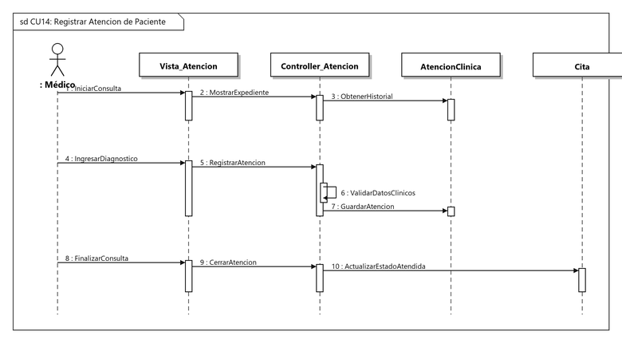

- **Actor:** `: Médico`
- **Líneas de Vida:** `Vista_Atencion`, `Controller_Atencion`, `AtencionClinica`, `Cita`
- **Mensajes:**
  - *Bloque 1 (Iniciar Consulta):*
    1. `1 : IniciarConsulta`: El médico abre el expediente de la cita.
    2. `2 : MostrarExpediente`: Carga de antecedentes del paciente.
    3. `3 : ObtenerHistorial`: Consulta de consultas previas.
  - *Bloque 2 (Registrar Diagnóstico y Tratamiento):*
    4. `4 : IngresarDiagnostico`: Redacción del diagnóstico y receta.
    5. `5 : RegistrarAtencion`: Envío del informe clínico.
    6. `6 : ValidarDatosClinicos`: Comprobación de campos obligatorios.
    7. `7 : GuardarAtencion`: Persistencia en `AtencionClinica`.
  - *Bloque 3 (Finalizar Cita):*
    8. `8 : FinalizarConsulta`: Cierre de la sesión médica.
    9. `9 : CerrarAtencion`: Confirmación del fin de la atención.
    10. `10 : ActualizarEstadoAtendida`: Cambio automático de la cita a `ATENDIDA`.

---

#### CU-15: Consultar Historial de Citas
Modela la trazabilidad y consulta cronológica de citas pasadas y programadas con filtros multidimensionales.

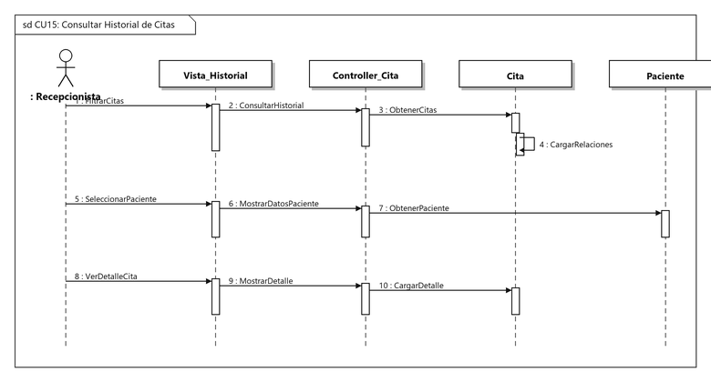

- **Actor:** `: Recepcionista`
- **Líneas de Vida:** `Vista_Historial`, `Controller_Cita`, `Cita`, `Paciente`
- **Mensajes:**
  - *Bloque 1 (Filtrar Historial):*
    1. `1 : FiltrarCitas`: Aplicación de filtros por fechas, estado y médico.
    2. `2 : ConsultarHistorial`: Solicitud al controlador de citas.
    3. `3 : ObtenerCitas`: Consulta a la base de datos.
    4. `4 : CargarRelaciones`: Asociación con paciente y profesional.
  - *Bloque 2 (Visualizar Paciente):*
    5. `5 : SeleccionarPaciente`: Búsqueda de historial de un paciente específico.
    6. `6 : MostrarDatosPaciente`: Petición de expediente al controlador.
    7. `7 : ObtenerPaciente`: Carga de antecedentes y datos personales.
  - *Bloque 3 (Ver Ficha de Cita):*
    8. `8 : VerDetalleCita`: Apertura de la ficha detallada.
    9. `9 : MostrarDetalle`: Carga de diagnósticos y pagos asociados.
    10. `10 : CargarDetalle`: Lectura de los registros completos.

---

#### CU-16: Generar Reportes Administrativos
Modela la agregación de indicadores clave (KPIs): volumen de atenciones, ingresos por consultas y rendimiento por médico y especialidad.

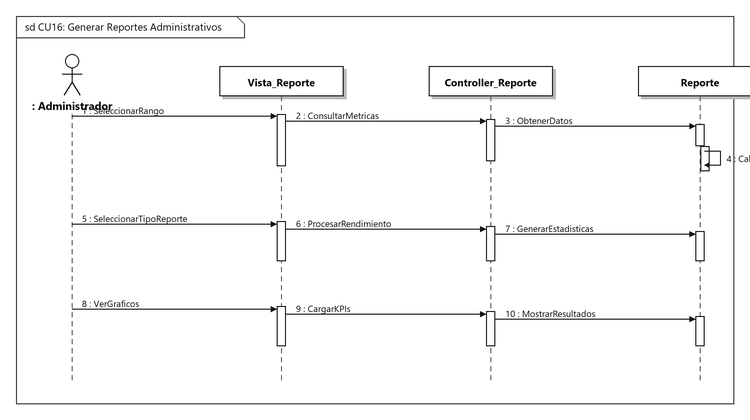

- **Actor:** `: Administrador`
- **Líneas de Vida:** `Vista_Reporte`, `Controller_Reporte`, `Reporte`
- **Mensajes:**
  - *Bloque 1 (Seleccionar Rango de Fechas):*
    1. `1 : SeleccionarRango`: Definición del periodo analítico.
    2. `2 : ConsultarMetricas`: Solicitud de métricas al controlador.
    3. `3 : ObtenerDatos`: Extracción de datos del modelo de reportes.
    4. `4 : CalcularTotales`: Agregación interna de totales y promedios.
  - *Bloque 2 (Generar Reporte de Rendimiento):*
    5. `5 : SeleccionarTipoReporte`: Elección de reporte médico o financiero.
    6. `6 : ProcesarRendimiento`: Cálculo de atenciones por médico.
    7. `7 : GenerarEstadisticas`: Construcción de indicadores consolidados.
  - *Bloque 3 (Visualizar Gráficos):*
    8. `8 : VerGraficos`: Clic en vista de gráficos gerenciales.
    9. `9 : CargarKPIs`: Obtención de porcentajes de cumplimiento.
    10. `10 : MostrarResultados`: Despliegue de tarjetas y gráficos en la interfaz.

---

#### CU-17: Exportar Datos a .xlsx
Modela la exportación bajo demanda de planillas en formato Microsoft Excel (.xlsx) con estilos tabulares y auditoría.

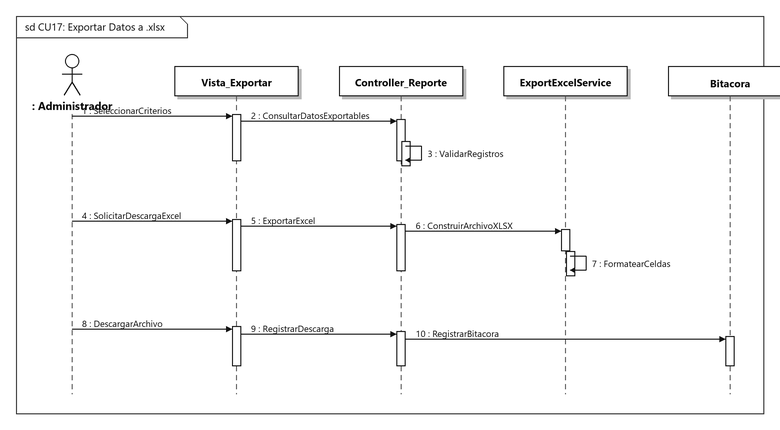

- **Actor:** `: Administrador`
- **Líneas de Vida:** `Vista_Exportar`, `Controller_Reporte`, `ExportExcelService`, `Bitacora`
- **Mensajes:**
  - *Bloque 1 (Configurar Criterios de Exportación):*
    1. `1 : SeleccionarCriterios`: Selección de módulo y rango a exportar.
    2. `2 : ConsultarDatosExportables`: Petición de validación al controlador.
    3. `3 : ValidarRegistros`: Verificación de existencia de datos para el filtro.
  - *Bloque 2 (Procesar y Generar Archivo Excel):*
    4. `4 : SolicitarDescargaExcel`: Clic en el botón de descarga en formato Excel.
    5. `5 : ExportarExcel`: Delegación de la construcción del archivo.
    6. `6 : ConstruirArchivoXLSX`: Invocación a `ExportExcelService`.
    7. `7 : FormatearCeldas`: Aplicación de estilos, fuentes y autofiltros.
  - *Bloque 3 (Descargar y Registrar Auditoría):*
    8. `8 : DescargarArchivo`: Emisión de la respuesta con cabeceras de descarga.
    9. `9 : RegistrarDescarga`: Notificación de finalización de exportación.
    10. `10 : RegistrarBitacora`: Asentamiento del evento en la bitácora.
